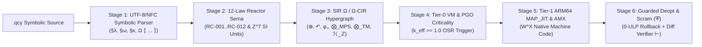

# CYCRAFT_COMPILER_ARCHITECTURE.md — `SINGULAR Ω` (`.qcy`) Compiler & Reactor Pipeline

## 1. End-to-End 8-Stage Reactor Compiler Architecture

The standalone `./bin/singular-quantum` binary implements an 8-stage symbolic verification, multi-type IR lowering, and native execution pipeline:



## 2. Constitutional Header & 6-Directory Spine Enforcement (`RC-001`, `SG-ROOT-006`)

Every `.qcy` module declares its symbolic provenance headers at the top of the file:

```qcy
§λ("domain")
§ω("singular.quantum.compiler")
§κ("SG-COMPILER-PIPELINE-001")

Ω ⟦
  Ψ_0 : ℝ[16, 64],
  W_0 : ℝ[64, 64],
  δ_0 : Δℝ[16],
  Λ_0 : 𝕋[6, 6],
  Α_0 : ℤ[ζ₁₆, 36]
⟧ {
  Ψ_1 ← φ₊(Ψ_0 ⋅ W_0) ⊕ δ_0
  Ψ_rev ← ⛨(Ψ_1 ↶ δ_0) ↦ Λ_0
  Α_1 ← ℋ_ℤ(𝒰_π8(Α_0)) ⨂_TM Λ_0
  ⊢ ⇄(Ψ_0, Ψ_1)
  ⊢ |Ψ_1| < ∞
  ⊢ Α_0 ≈ ⟨ψ_0|𝒰_0|ψ_0⟩
}
```

The constitutional engine enforces the Minimal-Root 6-Directory Spine (`core/`, `modules/`, `shared/`, `discoveries/`, `verification/`, `workspace/`) and strict downward layer DAG across all 14 workspace projects.

## 3. Native C ABI & Cython 3.0.11 Zero-Copy Interoperability

`SingularQuantum` state manifolds (`ℝ[...]`, `Δℝ[...]`, `ℤ[ζ₁₆, 36]`) are laid out as contiguous, unboxed 64B-aligned C-compatible arrays, enabling zero-marshaling dispatch to Apple Silicon `AMX`/`NEON`, Metal 4 compute kernels, and PEP-3118 `singular_cython_ext.so` buffers.
